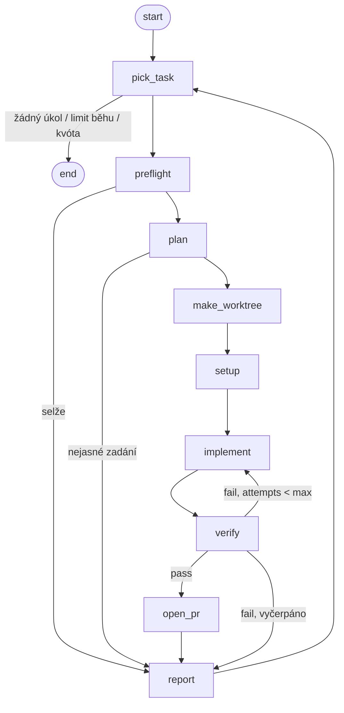

# Harness — fáze 1: design

Datum: 2026-10-01 · Stav: návrh ke schválení

## 1. Účel a kontext

Self-improving multi-agent harness nad složkou `Projects/`. Silný model orchestruje, levnější modely dělají práci. Primární cíl je **učení LangGraphu na reálných úkolech**, sekundární je produktivita.

Celkový plán (každý bod má vlastní spec → plán → implementaci):

| # | Podprojekt | Lekce LangGraphu |
|---|---|---|
| **1** | **Jedna smyčka + vizualizace + simulace (tento dokument)** | `StateGraph`, podmíněné hrany, retry, checkpointer, `interrupt_before` |
| 2 | Priority napříč projekty (sken projektů, secondbrain, backlog), paralelní workers | `Send`, subgrafy |
| 3 | Telegram: digest, chat, schvalování, dotazy na nejasné úkoly | `interrupt` / resume |
| 4 | Observabilita: tracing, nákladový ledger | tracing, metadata |
| 5 | Self-improvement: prompty, routing modelů, priority z feedbacku, PR do vlastního kódu | `Store`, evaly |

### Rozhodnutí z brainstormingu

- **Stack:** Python 3.11 + LangGraph. Volání modelů výhradně přes `claude-agent-sdk` (Python).
- **Placení:** subscription (Max). LangChain `ChatAnthropic` se **nepoužívá**, protože jede vždy přes API klíč. LangGraph slouží jen k orchestraci.
- **Běh:** přes den na tomto Windows PC v pozadí, zatímco uživatel pracuje. Spouští se ručně. PC nemusí běžet pořád, proto checkpointy.
- **Výstup:** draft PR. Do `main` harness nikdy nemerguje.
- **Pilotní projekty:** guth-pictures, secondbrain, akano3.
- **Konfigurace workerů:** jen projektový CLAUDE.md + vlastní prompt harnessu. Globální `~/.claude` (pluginy, hooky, CLAUDE.md) se nenačítá.
- **Architektura „tenký graf, tlustý worker“** (varianta A). Model se volá jen v uzlech `plan` a `implement`, vše ostatní je deterministický Python.

### Ověřená fakta (rešerše 2026-10-01)

- Podle [Legal and compliance](https://code.claude.com/docs/en/legal-and-compliance) je osobní použití neupraveného Claude Code s vlastní subscription povolené („ordinary, individual usage“). Zakázáno je směrovat požadavky cizích uživatelů přes Pro/Max credentials.
- Agent SDK a `claude -p` čerpají ze standardních limitů subscription. Anthropicem plánovaný přesun na samostatný kredit (15. 6. 2026) je **pozastavený, ne zrušený** → volání SDK drží na jednom místě, přepnutí na API klíč musí jít konfigurací.
- Když je v prostředí nastavený `ANTHROPIC_API_KEY`, SDK účtuje přes API → preflight ho musí odmítnout.
- `setting_sources` ve výchozím stavu načítá user + project + local → workers musí běžet s `setting_sources=["project"]`.
- Stream SDK posílá `RateLimitEvent` s `rate_limit_type` (`five_hour`, `seven_day`), `utilization` (0–1), `status` (`allowed` / `allowed_warning` / `rejected`) a `resets_at` → harness **umí měřit kvótu**.
- `ResultMessage` obsahuje `usage`, `model_usage` a `total_cost_usd` (u subscription jde o odhad).

## 2. Architektura

```
harness/
  harness/
    graph.py          # StateGraph + State; uzly dostává zvenku (real/fake)
    nodes/real.py     # Agent SDK, git, gh, verify příkazy
    nodes/fake.py     # řízené scénářem
    backlog.py        # parse + zápis BACKLOG.md
    projects.py       # load projects.yaml
    guard.py          # kontrola diffu
    events.py         # SQLite event log
    sdk.py            # JEDINÉ místo volání claude-agent-sdk
    cli.py            # run | simulate | dashboard
    dashboard/        # FastAPI app + static/index.html
    prompts/          # plan.md, implement.md (podklad pro budoucí self-improvement)
  scenarios/*.yaml
  tests/
  BACKLOG.md
  projects.yaml
  harness.db          # events + LangGraph checkpointy (gitignored)
```

Hranice jednotek:
- `graph.py` neví, jestli jsou uzly skutečné, nebo falešné. Dostane slovník `{node_name: callable}`.
- `sdk.py` je jediný modul, který importuje `claude_agent_sdk`. Vrací `WorkerResult(text, usage, cost, rate_limit)` nebo vyhodí `RateLimited(resets_at)`.
- Dashboard čte jen `harness.db` (events + checkpointy) a pro spuštění simulace volá `cli`.

## 3. Graf



### Stav (`TypedDict`)

| Pole | Obsah |
|---|---|
| `run_id`, `simulated` | identifikace běhu |
| `tasks_done` | počet zpracovaných úkolů v běhu |
| `task` | id, projekt, název, popis, priorita |
| `project` | záznam z `projects.yaml` |
| `plan` | text plánu |
| `worktree`, `branch` | cesta a `harness/<task-id>` |
| `baseline_failures` | testy, které padaly už na base větvi |
| `attempts`, `last_failure` | počítadlo; zkrácený výstup verify (max ~4 kB) |
| `outcome` | `pr_opened` / `failed` / `needs_clarification` / `paused` / `skipped` |
| `pr_url`, `usage` | odkaz; tokeny a cena podle uzlu |

### Uzly

1. **`pick_task`**: první `[ ]` úkol z `BACKLOG.md` podle priority (P1 > P2 > P3, při shodě pořadí v souboru) v projektu z `projects.yaml`. Běh skončí, když není žádný úkol, `tasks_done ≥ max_tasks_per_run` (výchozí 3), nebo poslední naměřené `five_hour.utilization ≥ quota_threshold` (výchozí 0.7, nechává rezervu pro uživatele).
2. **`preflight`**: `ANTHROPIC_API_KEY` není nastavený (pokud `billing: subscription`); `gh auth status` je OK; vzdálená větev `harness/<task-id>` ani otevřený PR neexistují (idempotence při resume).
3. **`plan`**: model `opus`, `permission_mode="plan"`, `cwd` = projekt. Výstup je plán, nebo řádek `UNCLEAR: <otázka>` → `needs_clarification`.
4. **`make_worktree`**: `git fetch` → `git worktree add Projects/.harness-worktrees/<projekt>/<task-id> -b harness/<task-id> origin/<base>`. Pokud worktree z přerušeného běhu už existuje, použije se znovu.
5. **`setup`**: příkazy `setup` z konfigurace (např. `npm ci`), pak verify příkazy jednou kvůli **baseline**. Testy, které padají už na base větvi, se uloží do `baseline_failures` a gate je nepočítá jako regresi.
6. **`implement`**: model `sonnet`, `cwd` = worktree, `setting_sources=["project"]`, `system_prompt` = preset `claude_code` + `append` z `prompts/implement.md`, `permission_mode="acceptEdits"`, `disallowed_tools=["Bash(git push*)", "Bash(git commit*)", "Bash(gh *)"]`. Vstup: úkol, plán a případně `last_failure`.
7. **`verify`** (bez modelu): verify příkazy v worktree; `guard`: diff není prázdný, všechny změněné cesty odpovídají `allowed` (pokud je definované), diff ≤ `max_diff_lines` (výchozí 800). Pass = žádné nové selhání oproti baseline a guard OK.
8. **`open_pr`**: `git add -A`, commit `harness: <task-id> <title>`, push, `gh pr create --draft` s plánem, výsledkem verify a usage v těle.
9. **`report`**: zapíše stav úkolu do BACKLOGu (`[x]` + URL / `[!]` + důvod / `[?]` + otázka), event `task_done`, zvýší `tasks_done`. Worktree při selhání zůstává (úklid ručně přes `harness prune`).

### Chybové cesty

- **`RateLimited`** z kteréhokoli uzlu s modelem → `outcome=paused`, event s `resets_at`, běh skončí. Checkpoint zůstane. `harness run --resume <run_id>` naváže od přerušeného uzlu.
- **Přechodné chyby** (`git fetch`, `push`, `gh`): `RetryPolicy(max_attempts=3)` na `make_worktree` a `open_pr`.
- **Pád procesu / vypnutí PC:** SQLite checkpointer (`langgraph-checkpoint-sqlite`), `thread_id = run_id`, resume.
- **Neočekávaná výjimka v uzlu** → event `error` se stack trace, `outcome=failed`, pokračuje se `report`.

## 4. Datové formáty

### `BACKLOG.md`

```markdown
## guth-pictures
- [ ] P1 gp-01 Lazy loading obrázků v galerii
  Popis a akceptační kritérium (odsazené řádky).
- [x] P2 gp-02 Oprava řazení alb → https://github.com/.../pull/42
- [!] P2 gp-03 Migrace na Vite 6 — verify fail 3× (run 17)
- [?] P3 gp-04 Zlepšit výkon — UNCLEAR: co měřit?
```

Řádek úkolu: `- [<stav>] P<1-3> <id> <název>`. ID musí být unikátní, jinak parser selže s chybou. Zápis mění jen značku stavu a příponu za ` → ` / ` — `; ostatní text zůstává beze změny.

### `projects.yaml` (pilot, ověřeno 2026-10-01)

```yaml
defaults:
  max_attempts: 3
  max_diff_lines: 800
billing: subscription          # subscription | api
max_tasks_per_run: 3
quota_threshold: 0.7

projects:
  guth-pictures:
    path: ../guth-pictures
    base: main
    setup: ["npm ci"]
    verify: ["npm test", "npx tsc --noEmit"]
  akano3:
    path: ../akano3
    base: main
    setup: ["npm ci"]
    verify: ["node --test lib/*.test.mjs", "npx tsc --noEmit"]
  secondbrain:
    path: ../secondbrain
    base: main
    setup: ["npm ci --prefix web", "python -m pip install -r bot/requirements.txt pytest"]
    verify: ["python -m pytest bot", "npm test --prefix web"]
    allowed: ["bot/**", "web/**", "scripts/**"]
```

Spuštěním ověřeno jen `node --test` v akano3. Ostatní příkazy pocházejí z `package.json` a struktury repa a ověří se v prvním kroku implementace.

Zjištění z ověřování:
- akano3 nemá `test` skript, testy jsou `node:test` v `lib/*.test.mjs`. Lokálně 28/29 projde, `wiki-map-layout` padá na `Cannot find package 'd3-force'`. **Bug mimo scope**, neopravuje se. Baseline mechanismus právě tohle pokrývá.
- Lokální guth-pictures je na větvi `codex/editorial-redesign`. Worktree se proto vytváří z `origin/main`, pracovní kopie uživatele zůstává netknutá.
- Telegram bot secondbrainu běží hodinově v **GitHub Actions**, ne lokálně. Důležité pro fázi 3.

### Scénář simulace

```yaml
name: Testy dvakrát spadnou, potřetí projdou
tasks:
  - {project: guth-pictures, id: sim-01, title: "Demo úkol", priority: P1}
nodes:                  # chybějící uzel = ok
  plan: ok
  verify: [{fail: "2 tests failed"}, {fail: "1 test failed"}, pass]
  open_pr: ok
delay: 0.8              # sekund na uzel (pro dashboard); v testech 0
```

Hodnoty uzlu: `ok` | `{fail: msg}` | `{unclear: msg}` | `{rate_limit: resets_in_s}` | `{error: msg}` | `{guard: "forbidden path bot/../Thoughts/x.md"}`; seznam = postupně po voláních. Simulace používá dočasný BACKLOG vytvořený ze `tasks`, nikdy nesahá na skutečný.

Scénáře fáze 1: `happy-path`, `flaky-tests`, `retries-exhausted`, `unclear-task`, `forbidden-path`, `rate-limit-pause-resume`.

### Event log (`harness.db`, tabulka `events`)

`id INTEGER PK, run_id TEXT, ts REAL, node TEXT, kind TEXT (run_start|start|end|error|task_done|run_end|paused), delta JSON, usage JSON, rate_limit JSON, simulated INTEGER`

Plní se z `graph.stream(..., stream_mode=["updates", "debug"])` v jednom místě v `cli`, uzly samy nic nezapisují.

## 5. Dashboard

`harness dashboard` spustí FastAPI na `localhost:8765`. Frontend je jedno statické `index.html`, vanilla JS, Mermaid z CDN, bez build kroku.

Endpointy: `GET /graph` (Mermaid z `get_graph().draw_mermaid()`), `GET /runs`, `GET /runs/{id}/events`, `GET /events/stream` (SSE, nové eventy), `GET /backlog`, `GET /usage`, `GET /scenarios`, `POST /simulate {scenario, step}`, `POST /runs/{id}/step`.

Pohledy:
1. **Graf:** Mermaid diagram, aktivní uzel zvýrazněný přes SSE. Klik na uzel ukáže poslední `delta`, trvání a tokeny.
2. **Běhy:** seznam (štítek real/sim) a časová osa uzlů, pokusy, výsledek, PR.
3. **Backlog:** úkoly podle projektů a stavů.
4. **Spotřeba:** tokeny a cena podle uzlu, modelu a dne; poslední `utilization` pro `five_hour` a `seven_day` a `resets_at`.
5. **Simulace:** výběr scénáře a režimu. *Plynulý* režim používá `delay`. *Krokovací* režim kompiluje graf s `interrupt_before=[všechny uzly]` a tlačítko „další krok“ volá `POST /runs/{id}/step` (`graph.invoke(None, config)`). Tentýž mechanismus později využije Telegram.

Bezpečnost: server poslouchá jen na `127.0.0.1`. `POST /simulate` spouští jen simulace, nikdy skutečný běh.

## 6. Testování

- **Unit testy:** `backlog` (parse, priorita, zápis stavu, duplicitní ID → chyba), `projects` (defaults, chybějící pole), `guard` (allowed glob, prázdný diff, limit), preflight (API klíč nastavený → fail), porovnání s baseline.
- **Scénářové testy:** každý scénář projde skutečným `graph.py` s `nodes/fake.py` a `delay: 0`. Asserty: `outcome`, pořadí `node` v events, výsledný BACKLOG.
- **Resume:** `rate-limit-pause-resume` → běh skončí `paused`; druhé spuštění se stejným `thread_id` pokračuje od uzlu `implement`, `make_worktree` se neopakuje (ověřeno počtem volání fake uzlu).
- **Dashboard:** FastAPI `TestClient` pro `/graph`, `/runs`, `/simulate`; jednou ruční kontrola v prohlížeči (screenshot přes Playwright).
- **`sdk.py`:** bez unit testů proti živému API; ověřuje se kritériem hotovosti č. 3.

## 7. Kritérium hotovosti fáze 1

1. `python -m pytest` je zelený, včetně všech 6 scénářů.
2. `harness simulate flaky-tests --step` + dashboard: krok po kroku je vidět, jak se `verify` dvakrát vrátí do `implement`, a pak `open_pr` (screenshot).
3. `harness run` na reálném malém úkolu v guth-pictures vytvoří **draft PR** se zeleným verify, s nenastaveným `ANTHROPIC_API_KEY`; event log obsahuje `rate_limit` info z subscription.
4. Skutečný běh zabitý během `implement` → `harness run --resume <id>` úkol dokončí; existuje právě jedna větev a jeden PR.
5. Spike při implementaci: worker se `setting_sources=["project"]` nenačte globální pluginy ani hooky. Ověří se dotazem na seznam dostupných skills a nástrojů v testovacím volání.

## 8. Mimo scope fáze 1

Telegram, sken projektů, čtení secondbrainu, paralelní workers, routing modelů podle dat, self-improvement, LangGraph Studio (volitelné; zda vyžaduje LangSmith login, není ověřeno), vzdálený běh.

## 9. Rizika

- **Přesun SDK na separátní kredit** → `billing: api` + strop; `sdk.py` je jediné místo, kterého se změna týká.
- **Kvóta sdílená s uživatelem** → `quota_threshold` a pauza na `allowed_warning` / `rejected`.
- **Worker udělá něco destruktivního v worktree** → izolovaný adresář, zákaz push/commit/gh, guard na diff, jen draft PR.
- **`npm ci` v každém worktree je pomalé** → akceptováno pro fázi 1. Optimalizace (sdílená cache) až bude vadit.
