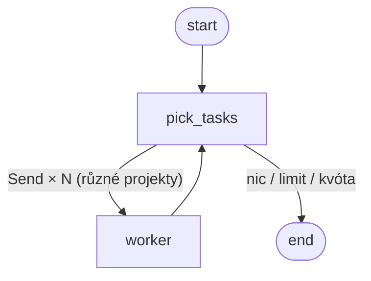

# Harness — fáze 2: design

Datum: 2026-10-01 · Stav: implementováno bez předchozího schválení (zadání „implementuj fázi dva“ přes `/goal`); rozhodnutí níže jsou defaulty, revize vítaná.

## 1. Účel

Z tabulky ve spec fáze 1: **Priority napříč projekty (sken projektů, secondbrain, backlog), paralelní workers** — lekce LangGraphu `Send` a subgrafy.

Fáze 1 bere úkoly jeden po druhém a mezi projekty rozhoduje jen `P1–P3` a pořadí v souboru. Fáze 2:

1. **Paralelní workers:** víc úkolů z různých projektů najednou (`Send` fan-out do worker subgrafu).
2. **Ranking napříč projekty:** priorita z BACKLOGu, pak „fokus“ ze secondbrainu (kde uživatel teď přemýšlí), pak váha projektu.
3. **Sken projektů:** `harness scan` najde v projektech `TODO`/`FIXME` a navrhne je jako úkoly. Návrh se nespustí sám — uživatel ho musí povýšit.

## 2. Rozhodnutí (defaulty)

| Otázka | Rozhodnutí | Proč |
|---|---|---|
| Paralelismus | `max_parallel` (výchozí 2) workerů v jedné dávce, **max 1 úkol na projekt** v dávce | souběžný `git worktree add` / `npm ci` ve stejném repu je zbytečné riziko |
| Plánování dávek | bariéra: další dávka až po doběhnutí všech workerů | jednoduché, deterministické; dynamický pool až bude vadit |
| Ranking | lexikograficky `(P, −fokus, −váha, pořadí v souboru)` | explicitní priorita uživatele vždy vyhrává; secondbrain jen rozhoduje remízy |
| Fokus ze secondbrainu | počet souborů v `Thoughts/` a `Inbox/` za posledních `days` (výchozí 14) dní, které zmiňují název projektu (`guth-pictures` ≈ `guth pictures`) | deterministické, bez modelu, bez tokenů |
| Sken | `git grep` `TODO`/`FIXME` na `origin/<base>` → BACKLOG se stavem `[~]` (návrh), P3, max 5 na projekt, stabilní ID z hashe | `[~]` se nikdy nespustí; povýšení = ruční změna na `[ ]` (Telegram schvalování až fáze 3) |
| Model ve skenu | žádný | sken je zdarma a testovatelný; modelový sken = kandidát pro fázi 5 |

## 3. Graf



`worker` je uzel, který volá zkompilovaný **worker subgraf** = celý graf fáze 1 bez `pick_task` (`preflight → make_worktree → plan → setup → implement ⇄ verify → open_pr → report → END`). Subgraf má vlastní stav (`WorkerState`); do rodiče vrací jen `tasks_done: +1`, `usage`, `quota` (reducery `add` / `add` / `max`), takže paralelní workers nekolidují.

Stav rodiče: `run_id, simulated, max_tasks, max_parallel, quota_threshold, tasks_done, quota, usage, batch`.

- **Resume:** subgraf dědí checkpointer rodiče, každý `Send` má vlastní namespace `worker:<task_id>`. `RateLimited` v jednom workeru ukončí běh jako `paused`; `--resume` zopakuje jen přerušený uzel přerušeného workera, hotový sourozenec se neopakuje (ověřeno spikem).
- **Krokování:** rodič `interrupt_before=["pick_tasks"]`, subgraf `interrupt_before=[všechny uzly]`. „Další krok“ posune všechny běžící workery o jeden uzel. `/runs/{id}/state` vrací vnitřní uzly přes `get_state(subgraphs=True)`.
- **BACKLOG z paralelních `report`:** zápis pod zámkem (read-modify-write).

## 4. Konfigurace (`projects.yaml`)

```yaml
max_parallel: 2
secondbrain: {path: ../secondbrain, days: 14}   # volitelné
projects:
  guth-pictures:
    weight: 1          # volitelné, výchozí 0; rozhoduje až po fokusu
```

## 5. Event log

Nový sloupec `worker TEXT` (ID úkolu, `NULL` pro uzly rodiče). Existující `harness.db` se migruje `ALTER TABLE` při `connect`. Runner streamuje `subgraphs=True` a mapuje namespace → ID úkolu.

## 6. CLI a dashboard

- `harness queue` — seřazená fronta otevřených úkolů s fokusem a váhou (bez spuštění čehokoli).
- `harness scan [--write]` — vypíše návrhy; s `--write` je připíše do BACKLOGu jako `[~]`.
- Dashboard: dva diagramy (rodič + worker subgraf), zvýraznění aktivního uzlu **každého** workera, sloupec workera v událostech, `[~]` v backlogu, nový scénář `parallel-projects`.

## 7. Kritérium hotovosti fáze 2

1. `python -m pytest` zelený: všechny scénáře fáze 1 beze změny výsledků + nové `parallel-projects`, `parallel-rate-limit`, ranking, secondbrain fokus, sken, migrace event logu.
2. Scénář `parallel-projects`: v event logu oba workery začnou dřív, než kterýkoli skončí (skutečný souběh), oba úkoly `[x]`.
3. `parallel-rate-limit`: běh `paused`, po resume `done`; hotový worker se neopakuje, přerušený neopakuje `make_worktree`.
4. Krokovací režim v dashboardu ukazuje dva workery krok po kroku (screenshot přes Playwright).
5. `harness queue` a `harness scan` běží nad skutečným `projects.yaml` / secondbrainem bez chyby.
6. **Ruční, mimo autonomní běh:** `harness run` se dvěma `[ ]` úkoly ve dvou projektech → dva draft PR. Vytváří PR na GitHubu a čerpá kvótu → spouští se jen se souhlasem uživatele.

## 8. Mimo scope

Modelový sken, signály z git aktivity, dynamický pool workerů, Telegram schvalování návrhů (fáze 3), tracing (fáze 4).
