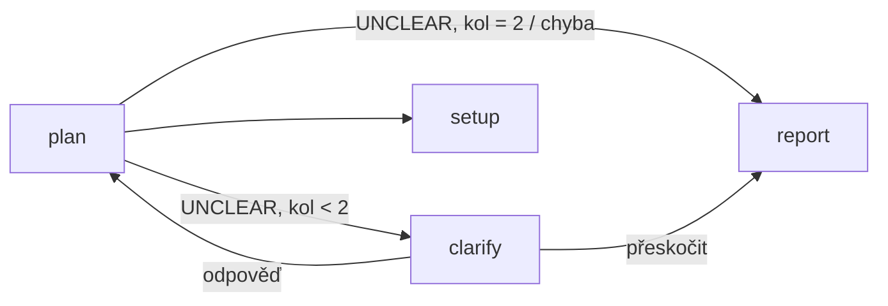

# Harness — fáze 3: design

Datum: 2026-10-02 · Stav: implementováno. Brainstorming s uživatelem (cíl, hosting, dotazy, chat, plánovač, notifikace), zbytek dotažen pod `/goal` jako defaulty — revize vítaná. Body 1–5 kritéria ověřeny; bod 6 (reálný bot) čeká na token.

## 1. Účel

Z tabulky ve spec fáze 1: **Telegram: digest, chat, schvalování, dotazy na nejasné úkoly** — lekce LangGraphu `interrupt` / resume s lidským vstupem.

Cíl uživatele: **harness běží autonomně na tomto PC, ovládání z mobilu.** Uživatel jen schvaluje návrhy, odpovídá na dotazy a dostává přehled.

## 2. Rozhodnutí

| Otázka | Rozhodnutí | Zdroj |
|---|---|---|
| Hosting | jeden proces `harness serve` na tomto PC: Telegram long polling (žádný veřejný webhook) + plánovač + běh ve vlákně | uživatel |
| Nejasný úkol | `plan` vrátí `UNCLEAR` → uzel `clarify` zavolá `interrupt({question})`, sourozenci doběhnou, run je `waiting`. Odpověď → `Command(resume=…)` → `plan` znovu s upřesněním. Max 1 run naráz, čekající run blokuje další | uživatel |
| Chat | jen příkazy + inline tlačítka, žádný LLM | uživatel |
| Plánovač | automatický start jen v časovém okně `serve.window` (např. `22:00-07:00`); mimo okno jen `/run` | uživatel |
| Notifikace | hned jen akce od uživatele (dotaz, návrh `[~]`, pád); vše ostatní v digestu po konci okna | uživatel |
| Telegram klient | stdlib `urllib`, 4 volání Bot API (`getUpdates`, `sendMessage`, `editMessageText`, `answerCallbackQuery`) | přístup A |
| Bot | **vlastní token** (`HARNESS_TELEGRAM_TOKEN`), ne secondbrain bot — dva `getUpdates` pollery na jednom tokenu si kradou updaty | default |
| Kola upřesnění | max 2 dotazy na úkol, pak `[?]` | default |
| Timeout dotazu | `serve.question_timeout_hours` (výchozí 24) → odpověď „přeskočit“ → `[?]`, run pokračuje | default |
| Zamítnutý návrh | nový stav `[-]`; řádek zůstává, aby ho `scan` znovu nenavrhl | default |
| Sken | démon spustí `scan --write` jednou denně na začátku okna (`serve.scan`, výchozí `true`) | default |
| Pád běhu | notifikace + automatický start se vypne (jako `/pause`), aby deterministický pád neběžel dokola | default |
| Bezpečnost | updaty z jiného chatu než `HARNESS_TELEGRAM_CHAT_ID` se ignorují — příkazy spouští běhy a čerpají kvótu | default |

## 3. Graf

Worker subgraf dostane uzel `clarify`:



- `clarify`: `answer = interrupt({"question", "task", "title", "project"})`. Neprázdná odpověď → `{"outcome": None, "last_failure": "", "clarifications": [...staré, answer]}` → `plan`. Prázdná → nic nemění, `outcome` zůstává `needs_clarification` → `report` zapíše `[?]` jako dosud.
- `plan.md` dostane blok `{clarifications}` („Upřesnění od vlastníka: …“).
- `clarify` není obalený `_safe`: nedělá nic, co by mohlo selhat, a `GraphInterrupt` nesmí spolknout.

**Ověřeno spikem** (2 paralelní workery v subgrafu přes `Send`, oba čekají): resume jen jednoho id (`Command(resume={id: …})`) dokončí jeho workera, druhý se znovu přeruší **se stejným id**. `get_state().interrupts` ale dál vrací i zodpovězený interrupt hotového workera → otevřené interrupty se berou jen z `tasks` s `result is None`. Totéž opravuje `_rate_limit_pauses` z fáze 2 (dosud neškodné, protože se resumovaly vždy všechny).

## 4. Runner

- `open_interrupts(app, config)` — interrupty nedokončených tasků (viz výše).
- `questions(app, config)` → `[{id, task, title, project, question}]`.
- `execute(..., answers: dict[str, str] | None = None)` — resume = `{id rate-limitu: True}` ∪ `answers`. **Zjištěno při implementaci:** resume znovu spustí *každý* přerušený uzel (rate-limitovaný uzel tedy zopakuje práci i bez resume hodnoty), selektivně resumovat nejde. Proto: dokud je běh `paused`, démon odpovědi jen řadí do fronty a resumuje až po `resets_at` — kvóta je sdílená, zodpovězený úkol by stejně narazil.
- Návratové stavy: `paused` (otevřený rate limit) > `waiting` (otevřený dotaz) > `interrupted` (krokování) > `done`. Event `waiting` s `delta.questions`.
- CLI `run` / `simulate`: při `waiting` se zeptá v terminálu (Enter = přeskočit) a pokračuje.
- Dashboard: `/runs/{id}/state` vrací `questions`, `POST /runs/{id}/answer {id, answer}`; frontend ukáže otázku s polem pro odpověď.

## 5. Démon `harness serve`

Smyčka: `getUpdates` (long poll 20 s) slouží zároveň jako tik. Běh grafu ve vlákně; hlavní vlákno jen obsluhuje Telegram a rozhoduje.

Každý tik:
1. Zpracuj updaty (jen z povoleného chatu).
2. Pokud neběží vlákno, podle stavu posledního běhu:
   - `running` (démon spadl během běhu) → resume.
   - `paused` a `now ≥ resets_at` → resume s rate limity.
   - `waiting` → odpovědi z fronty + timeouty → resume (rate limity jen pokud už vypršely).
   - jinak (`done` / žádný) a automatika zapnutá a v okně a fronta neprázdná → nový běh.
3. Na začátku okna (1× denně) sken → nové `[~]`.
4. Pošli nové dotazy (1× na interrupt id) a nové návrhy `[~]` (1× na id).
5. První tik po konci okna (1× denně) → digest.

Stav démona v `serve_state.json` (gitignored): `paused`, `run {id, status, resets_at}`, `offset`, `asked {interrupt id: {message_id, task, asked_at}}`, `answers {interrupt id: text}`, `proposals_sent`, `last_scan`, `last_digest`. Zápis do BACKLOGu z démona (schválení) pod stejným zámkem jako `report`.

### Telegram

| Vstup | Akce |
|---|---|
| `/status` | automatika, okno, běh + stav, otevřené dotazy, fronta, návrhy |
| `/queue` | prvních 10 z `rank` |
| `/proposals` | znovu pošle všechny `[~]` s tlačítky |
| `/run` | spustí běh hned (i mimo okno), pokud nic neběží/nečeká |
| `/pause`, `/resume` | vypne/zapne automatický start (běžící běh doběhne) |
| `/digest` | digest od posledního |
| tlačítko ✅ / ❌ u návrhu | `[~]` → `[ ]` / `[-]`, zpráva se přepíše na výsledek |
| odpověď (reply) na dotaz | uloží odpověď → resume |
| volný text, právě 1 otevřený dotaz | odpověď na něj |
| tlačítko „Přeskočit“ u dotazu | odpověď `""` |

Digest (text): běhy od posledního digestu, per úkol výsledek (PR URL / `failed: …` / `UNCLEAR`), tokeny a cena, velikost fronty a počet čekajících návrhů. Počítá se z event logu (poslední `delta.outcome` per běh a worker) + BACKLOGu.

## 6. Konfigurace

```yaml
serve:
  window: "22:00-07:00"       # bez window = žádný automatický start, jen /run
  question_timeout_hours: 24
  scan: true
```

Token a chat id jen z prostředí: `HARNESS_TELEGRAM_TOKEN`, `HARNESS_TELEGRAM_CHAT_ID`. Bez nich `harness serve` skončí s chybou.

## 7. Testování a kritérium hotovosti

1. `python -m pytest` zelený. Scénáře fáze 1–2 beze změny výsledků; `unclear-task` teď vrací `waiting`, po přeskočení stejné `[?]`.
2. Nové scénáře: `clarify-answered` (odpověď → `[x]`, `plan` 2×), `clarify-max-rounds` (3× nejasné → `[?]`), `parallel-clarify` (jeden worker čeká, druhý dokončí PR; po odpovědi oba `[x]`, hotový se neopakuje).
3. `serve` testy s fake Telegramem a simulovanými uzly: start jen v okně, `/run` mimo okno, `/pause`, dotaz → reply → `[x]`, timeout → `[?]`, schválení/zamítnutí návrhu, digest po okně, resume po rate limitu, resume po restartu démona, ignorování cizího chatu, pád → pauza + zpráva.
4. Telegram klient: tvar requestů (mock `urlopen`), chyba sítě/401 neshodí smyčku.
5. `harness serve` nad reálným `projects.yaml` bez tokenu skončí srozumitelnou chybou; s neplatným tokenem hlásí 401 a běží dál.
6. **Ruční (potřebuje token od @BotFather):** `/status` z mobilu odpoví; `/proposals` → ✅ změní BACKLOG.

## 8. Mimo scope

LLM chat, `/add` úkolu z mobilu, víc souběžných běhů, webhook, autostart démona (Task Scheduler — návod v README), tracing (fáze 4).
