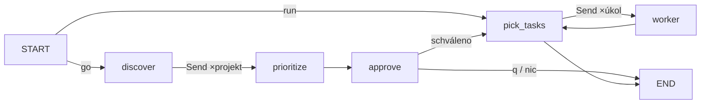

# Harness — `harness go`: design

Datum: 2026-10-07 · Stav: implementováno. Kritéria 1–2 ověřena; reálný `harness go` (go-20261008-005514): 3 projekty, 14 návrhů, 0 chyb, plán 3 bezpečnostních bugů — vlastník zvolil `q` (vše `[~]`), PR zatím nevznikl.

## 1. Účel

Cíl uživatele: **v terminálu jen říct „běž“ a harness si sám vymyslí, seřadí a rozdělí práci na projektech.** Dnes úkoly píše uživatel ručně do `BACKLOG.md` (a `scan` umí jen TODO/FIXME).

Lekce LangGraphu: map-reduce přes `Send` v rodičovském grafu, human-in-the-loop přes `interrupt` se strukturovaným payloadem, checkpoint drahého kroku.

Telegram/`serve` (fáze 3) zůstává v kódu, ale není předmětem této práce. Pořadí v roadmapě: tato práce se vkládá před fázi 4 (observabilita).

## 2. Rozhodnutí

| Otázka | Rozhodnutí | Zdroj |
|---|---|---|
| Autonomie | orchestrátor navrhne plán, uživatel ho **jednou** schválí v terminálu (Enter / škrtnutí), pak běží sám; výstup draft PR, nikdy merge | uživatel |
| Zdroje nápadů | analýza kódu, dokumentace projektu, poznámky secondbrainu (Thoughts/, Inbox/). Ne GitHub issues | uživatel |
| Rozdělení | úkol = 1 PR; orchestrátor rovnou navrhuje malé nezávislé úkoly, paralelní workery jako dnes | uživatel |
| Konec běhu | jedno kolo: objev → plán → schválení → odpracování → konec. Další kolo = nové spuštění | uživatel |
| Přístup | A: `discover` / `prioritize` / `approve` jako uzly rodičovského grafu | uživatel |
| Model | Opus pro `discover` i `prioritize` (orchestrace), workery beze změny (Opus plan, Sonnet implement) | default |
| Velikost plánu | `max_tasks_per_run` | default |
| Návrhy na projekt | max 5 | default |

## 3. Graf



- Počáteční stav nese `discover: bool`. Podmíněná hrana ze `START`: `True` → fan-out `Send("discover", {project})` pro každý projekt z `projects.yaml`, jinak `pick_tasks` (dnešní `harness run` beze změny).
- `State` dostane:
  - `proposals: Annotated[list[dict], operator.add]` — výstupy paralelních `discover`,
  - `plan: list[dict]` — výstup `prioritize` (`{id, project, title, description, kind, why, source: new|backlog}`),
  - `planned: list[str] | None` — schválená ID v pořadí; `None` = režim `run`.
- Checkpoint po každém uzlu → `--resume` po rate limitu / pádu nespouští znovu dokončené `discover`.

## 4. Uzly

### `discover` (jeden projekt)

- Worktree `.harness-worktrees/<projekt>/_discover` přes `ensure_worktree` (větev `harness/_discover` z `origin/<base>`), nevidí rozdělanou pracovní kopii. `ensure_worktree` existující worktree jen vrátí → před každým `discover` `git fetch` + `git reset --hard origin/<base>` v něm, ať je čerstvý. `prune` ho nemaže (není úkol), to nevadí.
- `run_agent(model="opus", tools=READ_TOOLS, permission_mode="dontAsk", max_turns=40)`, prompt `prompts/discover.md`.
- Do promptu:
  - `verify` příkazy projektu (úkol musí jít ověřit),
  - všechny existující úkoly projektu z BACKLOGu (vč. `[-]`, `[x]`) — nenavrhovat duplicity,
  - zmínky projektu ze secondbrainu za `secondbrain.days` (`_recent_captures` + `_mention_re`), zkrácené na ~8 000 znaků, nejnovější první,
  - limit `max_diff_lines` a pravidlo „jeden PR, nezávislý na ostatních“.
- Výstup: jediný JSON blok `[{title, description, kind, why, done}]`, `kind ∈ test|bug|debt|feature|docs`, `done` = ověřitelné kritérium hotovosti.
- Parsování (`harness/discover.py`, čistá funkce): první JSON pole v textu (i v ```json bloku), max 5 položek, položky bez `title` zahozeny, ID `<projekt>-ai-<sha1(title)[:6]>`, ID nebo titulek už v BACKLOGu → vyřazeno.
- Chyba (nevalidní JSON, pád agenta) → `proposals: []` + událost v event logu; ostatní projekty pokračují. Rate limit → `_safe` interrupt jako ve workeru.

### `prioritize`

- `run_agent(model="opus", tools=[], max_turns=1)`, prompt `prompts/prioritize.md`.
- Vstup: všechny `proposals`, otevřené `[ ]` úkoly z BACKLOGu, fokus projektů (`config_focus`), váhy projektů, limit N = `max_tasks_per_run`.
- Výstup: JSON `[{id, why}]` seřazený od nejdůležitějšího. Neznámá ID zahozena, duplicity zahozeny, oříznuto na N.
- Fallback (chyba agenta / prázdný nebo nevalidní výstup): `rank()` nad kandidáty (návrhy jako P2), `why = "fallback: pořadí podle priority"`, v terminálu vidět.

### `approve`

- `interrupt({"plan": [...]})`, odpověď je text.
- Terminál (`harness go`, `simulate`) vypíše:
  ```
  1. [guth-pictures] test  Unit testy pro lib/og.ts — chybí pokrytí… (nový)
  2. [akano3]        bug   … (z BACKLOGu)
  Enter = vše, čísla = vyškrtnout (2,5), q = konec:
  ```
- Parsování odpovědi (čistá funkce): `""` → vše; `"2,5"` / `"2 5"` → bez 2 a 5; `"q"` → nic; čísla mimo rozsah nebo jiný text → `ValueError`, terminál se ptá znovu.
- Zápis do BACKLOGu pod `edit_backlog`:
  - schválené nové návrhy → `[ ]` (P2) s `description` + `Hotovo = <done>`,
  - vyškrtnuté nové návrhy → `[-]` (příště se nenavrhnou),
  - nové návrhy, které `prioritize` nevybral → `[~]` (na později),
  - úkoly z BACKLOGu se jen řadí, stav nemění (vyškrtnutý zůstává `[ ]`).
- `planned` = schválená ID v pořadí plánu. Prázdné → `END`.

### `pick_tasks` (změna)

- `planned` není `None` → kandidáti jen otevřené úkoly s ID v `planned`, seřazené podle pořadí v `planned` (místo `rank()`); `pick_batch` (max 1 úkol na projekt v dávce), kvóta i `max_tasks` beze změny.

## 5. CLI

- `harness go` — nový běh s `discover=True`; interrupt `approve` řeší terminál (jako dnešní dotazy `clarify`). `harness run --resume RUN_ID` resumuje i běh z `go`.
- `harness simulate <scénář>` — scénáře s klíčem `discover` spouští režim go.

## 6. Simulace

- Falešné `discover` / `prioritize` čtou ze scénáře: `discover: {demo: [{title…}], other: {rate_limit: 1}}`, `prioritize: [ids…]` nebo `error`.
- Scénáře:
  - `go-happy` — 2 projekty → plán → Enter → PR,
  - `go-discover-rate-limit` — pauza v jednom projektu; po resume se `discover` druhého znovu nevolá (počítadlo volání),
  - `go-reject-all` — `q` → konec bez workerů.

## 7. Testy a kritérium hotovosti

Unit testy: parsování `discover` (validní, v textu / ```json, nevalidní → `[]`, >5 oříznuto, stabilní ID, duplicita k BACKLOGu), parsování `prioritize` (neznámá ID, oříznutí, fallback), parsování odpovědi `approve` (`""`, `2,5`, `q`, nesmysl), zápis stavů `[ ]`/`[-]`/`[~]`, `pick_tasks` s `planned` (pořadí, 1 na projekt), graf: větev go vs run.

Hotovo, když:
1. `python -m pytest` zelené včetně nových testů.
2. `harness simulate go-happy` doběhne a BACKLOG má očekávané stavy.
3. Reálný `harness go` nad pilotními projekty ukáže plán s ≥3 smysluplnými úkoly a po schválení vznikne ≥1 draft PR se zeleným verify.

## 8. Mimo scope

Schvalování plánu z dashboardu (jen zobrazí `waiting`) a z Telegramu, GitHub issues, víc kol bez schválení, podagenti uvnitř workeru, učení priorit z feedbacku (fáze 5).

## 9. Rizika

- **`discover` je drahý** (Opus × projekty) → checkpoint, max 40 tahů, kvóta se kontroluje před `pick_tasks` jako dnes.
- **Model navrhuje zbytečnosti / duplicity** → schválení uživatelem, dedup podle ID i titulku, `[-]` si pamatuje odmítnuté.
- **Návrh je moc velký na 1 PR** → prompt + `max_diff_lines`; guard ve workeru zůstává.
