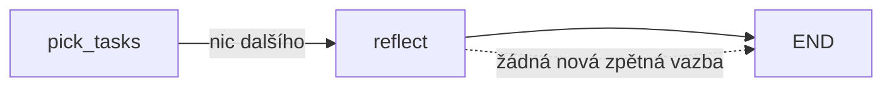

# Harness — fáze 5: self-improvement (design)

Datum: 2026-10-09 · Stav: implementováno, kritéria 1–3 ověřena testy (`test_rejected_proposal_becomes_lesson_in_next_discover_prompt`, `test_repeated_failure_proposes_harness_prompt_change`, `test_harness_project_may_only_touch_its_prompts`). Kritérium 4 čeká na ostrý běh.

## 1. Účel

Z roadmapy (spec fáze 1): **Self-improvement: prompty, routing modelů, priority z feedbacku, PR do vlastního kódu**. Lekce LangGraphu: `Store` (dlouhodobá paměť napříč běhy) a evaly.

Cíl: harness přestane opakovat stejné chyby. Návrhy, plány a implementace mají brát v úvahu, co vlastník zamítl, co zavřel bez merge a na čem worker opakovaně padal.

### Co je k dispozici (stav 2026-10-09)

| Zdroj | Obsah | Objem |
|---|---|---|
| `agent_calls` / `agent_steps` | volání a kroky agenta, tokeny, cena | 23 volání, 5 ostrých běhů |
| `task_outcomes` | stav PR z `gh` | 7 úkolů: 4 merged, 3 open, 0 closed |
| `BACKLOG.md` | `[-]` zamítnuté, `[?]` nejasné, `[!]` selhané, `[~]` neschválené | 1 zamítnutý, 23 návrhů čeká |
| `events` | `last_failure` z verify a guardu, počet pokusů | 5 běhů |
| prompty | `harness/prompts/{discover,prioritize,plan,implement}.md` | statické |

Závěr: na statistiku je dat řádově málo. Routing modelů nebo váhy priorit z úspěšnosti by se učily ze šumu. Fáze 5 proto začíná kvalitativní zpětnou vazbou (proč) místo čísel (kolik).

## 2. Rozsah

**Ano:**
1. **Sběr zpětné vazby:** důvod zamítnutí návrhu, review komentáře a zavření PR, selhání verify a guardu.
2. **Lekce:** krátká pravidla pro každý projekt, uložená v LangGraph `Store` a vkládaná do promptů.
3. **Reflexe:** uzel na konci běhu, který ze zpětné vazby navrhne nové lekce.
4. **Harness jako projekt:** návrhy změn vlastních promptů jdou jako draft PR do harnessu, nikdy jako automatický merge.

**Ne (odloženo s důvodem):**
- **Routing modelů podle dat:** potřeba aspoň ~30 dokončených úkolů na kombinaci uzel×model. Dnes je Opus plan a Sonnet implement natvrdo v `nodes/real.py` a to stačí.
- **Číselné váhy priorit z feedbacku:** stejný důvod. Míra schválení se jen předá jako text do promptu `prioritize` (§4.3).
- **Evaly s ostrým modelem:** každé kolo stojí kvótu. Regresní brána pro prompty zůstává na simulacích a testech (§6).

## 3. Zpětná vazba

| Signál | Kde vzniká | Jak se zachytí |
|---|---|---|
| zamítnutý návrh + důvod | dashboard ❌, Telegram ❌, škrtnutí v plánu `go` | ❌ v dashboardu otevře volitelné pole „proč“. V Telegramu se důvod pošle jako reply na zprávu návrhu. Uloží se k úkolu jako `— zamítnuto: <důvod>` (dnes jen `— zamítnuto`) |
| PR zavřený bez merge | `sync_outcomes` → `closed` | už existuje, nově se načte i poslední review komentář (`gh pr view --json reviews,comments`) |
| review komentáře na mergnutém PR | `gh` | stejně, jen pro PR úkolů harnessu |
| selhání verify a guardu | `last_failure` v events | už existuje, reflexe ho čte |
| `[?]` nejasný úkol | clarify | otázka + odpověď (nebo přeskočení) z checkpointu |

**Implementace (zjednodušení oproti návrhu):** žádná tabulka `feedback`. Zpětná vazba se odvozuje při každé reflexi z BACKLOGu (`[-]`, `[!]`, `[?]` včetně poznámky za `—`, kde je i důvod zamítnutí) a z PR úkolů `[x]` (`gh pr view --json state,reviews,comments`, jen komentáře lidí s `authorAssociation` OWNER/MEMBER/COLLABORATOR, ne boti). Klíč položky je `<kind>:<task id>` a `kind` je `rejected | failure | unclear | closed | review`. Store v namespace `("feedback",)` si pamatuje zpracované klíče. Otevřený PR se kontroluje znovu příště. Mergnutý PR bez komentářů se označí jako zpracovaný bez volání modelu.

## 4. Lekce (lekce LangGraphu: `Store`)

### 4.1 Úložiště

- `langgraph.store.sqlite.SqliteStore` nad `harness.db` (ověřeno: je v `langgraph-checkpoint-sqlite`).
- Graf se kompiluje s `store=`. Uzly si ho berou přes `langgraph.config.get_store()`. Funguje to i ve workerovém subgrafu spuštěném přes `sub.invoke` (ověřeno), takže se signatury uzlů ani `explore`/`rank_fn` nemění. Mimo graf `get_store()` vyhodí `RuntimeError` a `lessons.current_store()` vrátí `None`.
- Spojení musí být v autocommit režimu (`isolation_level=None`), jinak SqliteStore spadne na `cannot start a transaction within a transaction`. Simulace dostávají `InMemoryStore`, takže simulované lekce se nikdy nedostanou do `harness.db`.
- Namespace `("lessons", <projekt>)` pro projekt, `("lessons", "*")` pro všechny projekty.
- Hodnota: `{"text": "…", "source": [feedback ids], "created": ts, "status": "active" | "proposed" | "retired", "hits": n}`.
- Strop 15 aktivních lekcí na projekt. Při překročení reflexe navrhne sloučení nebo vyřazení, nikdy tiché smazání.

### 4.2 Použití v promptech

`discover`, `plan` a `implement` dostanou blok:

```
Lekce z minulých běhů (dodržuj):
- akano3: testy jsou node --test v lib/*.test.mjs, žádný vitest
- guth-pictures: vlastník nechce další unit testy pro lib/ bez souvislosti s bugem
```

Prompty v `harness/prompts/*.md` dostanou placeholder `{lessons}`. Bez lekcí je blok prázdný a prompt se chová jako dnes.

### 4.3 Priority

`prioritize` navíc dostane krátkou statistiku z BACKLOGu za posledních 30 dní: kolik návrhů projektu bylo schváleno, zamítnuto a mergnuto, rozdělené podle `kind`. Jde jen o text pro model, žádný vzorec.

## 5. Reflexe

Nový uzel `reflect` v rodičovském grafu po posledním `pick_tasks` (před `END`), jen když existuje nezpracovaná zpětná vazba.



- Model Opus, 1 tah, bez nástrojů (jako `prioritize`). Vstup: nezpracovaná `feedback`, aktuální lekce projektu a kroky volání, která selhala (zkrácené z `agent_steps`).
- Výstup v JSON. Každá položka nese `project`, `text`, `source` a `scope` (`project | prompt`), u `prompt` navíc `title`. Reflexe lekce jen přidává. Slučování a vyřazování dělá vlastník (dashboard, `harness lessons --retire`). Model dostane i vyřazené lekce, aby je znovu nenavrhoval. Při 15 aktivních lekcích schválení další odmítne s hláškou „nejdřív nějakou vyřaď“.
- `scope: project` zapíše lekci jako `proposed`. Aktivní se stane až po schválení vlastníkem (§8).
- `scope: prompt` znamená, že problém neleží v projektu, ale v promptu harnessu (např. „plan opakovaně nenačte CLAUDE.md projektu“). Z toho vznikne návrh `[~]` v sekci `## harness` v BACKLOGu → §6.
- Selhání reflexe běh nezhodí (`_pausing`, stejně jako `discover`).
- Simulace: falešný `reflect` řízený scénářem. Nové scénáře `reflect-lesson` a `reflect-prompt`.

## 6. Harness jako projekt (PR do vlastního kódu)

`projects.yaml`:

```yaml
  harness:
    path: .
    base: main
    setup: ['python -m venv ..\_hvenv && ..\_hvenv\Scripts\python -m pip install -q -e ".[dev]"']
    verify: ['..\_hvenv\Scripts\python -m pytest -q']
    allowed: ["harness/prompts/**", "CHANGELOG.md"]
```

- `allowed` pouští jen prompty. Guard zamítne jakoukoli změnu Python kódu, takže harness si nemůže přepsat vlastní guard, billing check ani tento allowlist.
- Úkoly pro harness vznikají jen z reflexe (`scope: prompt`) nebo ručně. `discover` harness neprochází, aby nevymýšlel změny pro změnu.
- Regresní brána je `pytest` včetně simulací (zachytí rozbitý placeholder nebo formát promptu). Jestli je nový prompt lepší, ukáže až další ostrý běh. To je vědomé omezení místo drahých evalů.
- Výstup je jako vždy draft PR. Merge dělá vlastník.

## 7. Výstupy

- **Dashboard `/desktop`:** sekce „Lekce“ s navrženými lekcemi (✅/❌), počtem aktivních lekcí na projekt a odkazem na zdroj (zamítnutý návrh nebo PR). ❌ u návrhu nabídne pole pro důvod.
- **`harness lessons [--project X]`:** výpis lekcí a `--retire ID`.
- **Telegram:** navržené lekce s ✅/❌ stejně jako návrhy úkolů. Po ❌ u návrhu úkolu jde poslat důvod reply na zprávu. Digest lekce neuvádí, chodí hned jako samostatné zprávy.

## 8. Rozhodnutí

| Otázka | Rozhodnutí | Zdroj |
|---|---|---|
| Schvalování lekcí | každou lekci schvaluje vlastník (✅/❌ v dashboardu nebo Telegramu). Do té doby je `proposed` a do promptů se nedostane | uživatel |
| Harness na sobě | ano, draft PR jen do `harness/prompts/**` a `CHANGELOG.md`. Python kód chrání guard | uživatel |
| Důvod zamítnutí | volitelný | uživatel |
| Routing modelů, číselné priority, evaly s ostrým modelem | odloženo, málo dat (§2) | default |

## 9. Kritéria hotovosti

1. Simulace `reflect-lesson`: zamítnutý návrh s důvodem → reflexe navrhne lekci → po schválení je lekce v promptu dalšího `discover` (assert na text promptu ve falešném uzlu).
2. Simulace `reflect-prompt`: opakované selhání stejného typu → návrh `[~]` v sekci `## harness`.
3. Guard: worker harnessu se změnou `harness/guard.py` → `failed` s hláškou guardu (test).
4. Ostrý běh: aspoň jedna lekce vzniklá z reálného zamítnutí nebo review se objeví v promptu následujícího `go` (ověří se v `agent_steps` / transkriptu).

## 10. Odhad

Zhruba ve velikosti fáze 4. Skutečný rozsah: modul `lessons.py`, uzel `make_reflect` v `nodes/common.py`, prompt `reflect.md`, úprava 4 promptů, rozšíření dashboardu a serve a 2 scénáře. Ostrý běh reflexe stojí jedno volání Opus s jedním tahem (řádově jako `prioritize`, ~0,1 $ podle dosavadních dat).
